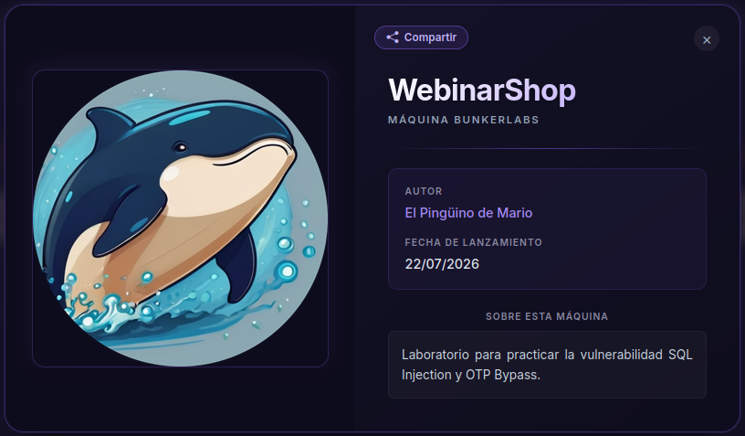
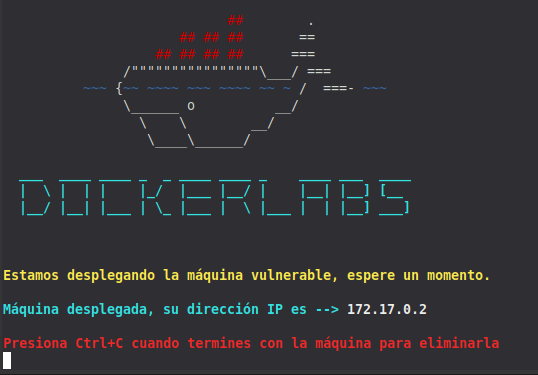
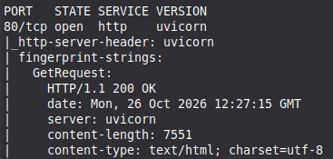
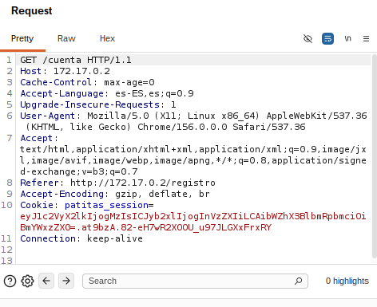
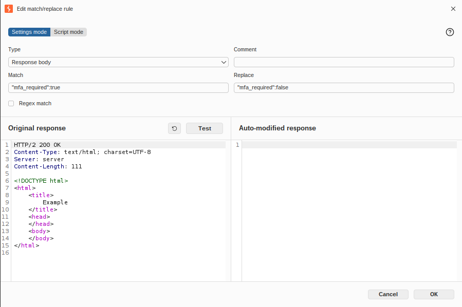

## Información general

- **Plataforma:** Dockerlbs
- **Sistema operativo:** Linux
- **Dificultad:** Fácil
- **Objetivo:** Practicar la vulnerailidad SQL Injection y OTP Bypass
- **IP del laboratorio:** 172.17.0.2

## Reconocimiento

###  Identificación del objetivo

Descargo la máquina desde la plataforma DockerLabs y descomprimo el archivo proporcionado para preparar su despliegue.

```bash
unzip WebinarShop
```

A continuación, ejecuto el script de automatización incluido con el laboratorio:

```bash
sudo bash auto_deploy.sh WebinarShop.tar
```

Una vez desplegado el entorno, identifico la dirección IP asignada a la máquina objetivo:

```text
172.17.0.2
```


### Escaneo de puertos

Realizo un escaneo de puertos TCP con Nmap para identificar los servicios expuestos por la máquina objetivo.

```
nmap -p- --open -sS -sC -sV --min-rate=5000 -vvv -n -Pn -oN escaneo TARGET_IP
```

- `-p-`: analiza todos los puertos TCP, del 1 al 65535.
- `--open`: muestra los puertos que Nmap identifica como abiertos.
- `-sS`: realiza un escaneo TCP SYN.
- `-sC`: ejecuta los scripts predeterminados de Nmap.
- `-sV`: intenta identificar las versiones de los servicios.
- `--min-rate=5000`: establece una tasa mínima de envío de 5000 paquetes por segundo, si las condiciones lo permiten.
- `-vvv`: aumenta el nivel de detalle de la salida.
- `-n`: evita la resolución DNS.
- `-Pn`: omite la detección inicial de disponibilidad del host.

El escaneo identifica el siguiente servicio:



| Puerto | Servicio | Información identificada |
| ------ | -------- | ------------------------ |
| 80/TCP | HTTP     | Servidor Web unicorn     |

La presencia de un servicio HTTP indica que existe una superficie de ataque web que debe analizarse mediante la inspección de páginas, formularios, parámetros y peticiones al servidor.

A partir de estos resultados, continúo con la enumeración web y reviso si la información publicada proporciona algún dato relevante.

## Enumeración

### Servicio HTTP

Con el servicio web identificado, utilizo Feroxbuster para buscar directorios y archivos accesibles.

La enumeración inicial no proporciona resultados relevantes. Por ello, continúo con la inspección manual de la aplicación.

Durante la navegación identifico una opción de autenticación y procedo a registrar una cuenta de usuario para analizar las funcionalidades disponibles.

Después del registro, observo que la aplicación asigna al nuevo usuario un rol de invitado.

Este comportamiento permite identificar que la aplicación gestiona roles de usuario. Sin embargo, la existencia de una base de datos no puede confirmarse únicamente por este hecho; será necesario obtener evidencias adicionales.

## Interceptación de peticiones HTTP

Utilizo Burp Suite para interceptar y examinar las peticiones HTTP generadas durante la interacción con la aplicación.

El objetivo es identificar los parámetros enviados al servidor y comprobar si alguno podría ser susceptible a una inyección SQL.


 
Guardo la petición seleccionada en un archivo de texto para utilizarla posteriormente con sqlmap.

## Explotación de SQL Injection

A partir de la petición capturada, utilizo sqlmap para comprobar si existe una posible vulnerabilidad de inyección SQL y determinar si es posible consultar información de la base de datos.

El comando utilizado durante la práctica fue:

```
sqlmap -r peticiones.txt -p "User-Agent" --batch --dbms=sqlite -T users -C username,password,role,mfa_enabled --dump
```

- `-r-`: Carga una petición HTTP previamente guardada.
- `-p`: Indica el parámetro que se desea probar. Debe coincidir con el punto de entrada realmente vulnerable.
- `--batch`: Utiliza las respuestas predeterminadas de sqlmap sin solicitar confirmaciones interactivas.
- `--dbms`: Indica el sistema gestor de base de datos.
- `-T`: Especifica la tabla.
- `-C`: Selecciona las columnas indicadas.
- `--dump`: Solicita la extracción de los datos de las columnas seleccionadas.

La ejecución de sqlmap permite obtener registros de la tabla `users` 

La información obtenida muestra que la cuenta de administrador tiene habilitado el mecanismo MFA.

Este hallazgo proporciona un nuevo punto de análisis: investigar cómo se implementa la verificación adicional durante el proceso de autenticación.


## Identificación del mecanismo de autenticación

Utilizo Burp Suite para examinar el flujo de autenticación y observar cómo la aplicación procesa las solicitudes relacionadas con el segundo factor.

El propósito de esta fase es comprobar si la validación del segundo factor se realiza correctamente en el servidor y si existe alguna posibilidad de omitirla.



Consigo acceder a la aplicación con privilegios de administrador demostrando un fallo en el flujo de autenticación de la aplicación. 


## Análisis de seguridad y mitigaciones

### Hallazgo 1: SQL Injection

**Descripción**

La aplicación permite realizar consultas no autorizadas a la base de datos mediante una entrada vulnerable a inyección SQL.

**Causa raíz**

Entre las causas habituales se encuentran la construcción de consultas mediante concatenación de entradas y la ausencia de consultas parametrizadas.

**Impacto potencial**

- Exposición de información de usuarios.
    
- Divulgación de credenciales almacenadas.
    
- Obtención de información sobre roles y mecanismos de autenticación.
    
- Posible compromiso de otras cuentas, dependiendo de las condiciones y de las protecciones existentes.
    

**Mitigaciones recomendadas**

- Utilizar consultas parametrizadas o sentencias preparadas.
    
- Evitar construir consultas SQL mediante concatenación de entradas.
    
- Aplicar el principio de mínimo privilegio a la cuenta de base de datos.
    
- No almacenar contraseñas en texto plano; utilizar algoritmos específicos para contraseñas, como Argon2id.
    
- Limitar la información de error que recibe el usuario.
    
- Incorporar pruebas de seguridad automatizadas y revisión del código.
    
### Hallazgo 2: Bypass de MFA/OTP

**Descripción**

Las pruebas realizadas permiten acceder a la aplicación como administrador sin completar correctamente el proceso de verificación multifactor esperado.

**Causa raíz**

Debe identificarse si el problema está en la validación del código, en el estado de la sesión, en la lógica de autenticación o en otra condición del servidor.

**Impacto potencial**

- Acceso no autorizado a cuentas privilegiadas.
    
- Elusión de una medida de seguridad adicional.
    
- Posible exposición o modificación de información administrativa.
    

**Mitigaciones recomendadas**

- Validar el segundo factor en el servidor, sin confiar en parámetros controlados por el cliente.
    
- Vincular el resultado de la verificación MFA a la sesión y al usuario correspondientes.
    
- No conceder acceso completo antes de completar todos los factores requeridos.
    
- Implementar caducidad, uso único y límites de intentos para los códigos OTP.
    
- Invalidar los estados de autenticación incompletos y proteger los cambios de sesión.
    
- Registrar y monitorizar intentos fallidos y comportamientos anómalos de autenticación.

## Conclusiones

La resolución de WebinarShop me permitió practicar una metodología de evaluación de seguridad web que incluye reconocimiento, enumeración, análisis de peticiones HTTP y explotación controlada.

La SQL Injection me permitió acceder a información de la base de datos, incluyendo datos relacionados con los usuarios, sus roles y la configuración de MFA. Posteriormente, el análisis del flujo de autenticación me permitió identificar una forma de acceder a la aplicación con privilegios administrativos.

Los principales aprendizajes son:

- La importancia de analizar las entradas y los parámetros de una aplicación web.
    
- El uso de Burp Suite para inspeccionar las comunicaciones entre cliente y servidor.
    
- La utilidad de sqlmap para validar y analizar posibles inyecciones SQL.
    
- La necesidad de implementar correctamente los controles de autenticación multifactor.
    
- La importancia de documentar evidencias y proponer medidas de mitigación.
    
Esta práctica refuerza los conocimientos de enumeración web, análisis de vulnerabilidades y evaluación de mecanismos de autenticación.

## Referencias

- [DockerLabs](https://dockerlabs.es/) : plataforma de laboratorios de práctica.    
- [sqlmap](https://sqlmap.org/) : documentación oficial.    
- [PortSwigger Web Security Academy](https://portswigger.net/web-security) : formación y documentación sobre vulnerabilidades web.    
- [OWASP Top 10:2021 A03 Injection](https://owasp.org/Top10/A03_2021-Injection/).    
- [OWASP Authentication Cheat Sheet](https://cheatsheetseries.owasp.org/cheatsheets/Authentication_Cheat_Sheet.html).    
- [OWASP Multifactor Authentication Cheat Sheet](https://cheatsheetseries.owasp.org/cheatsheets/Multifactor_Authentication_Cheat_Sheet.html).
